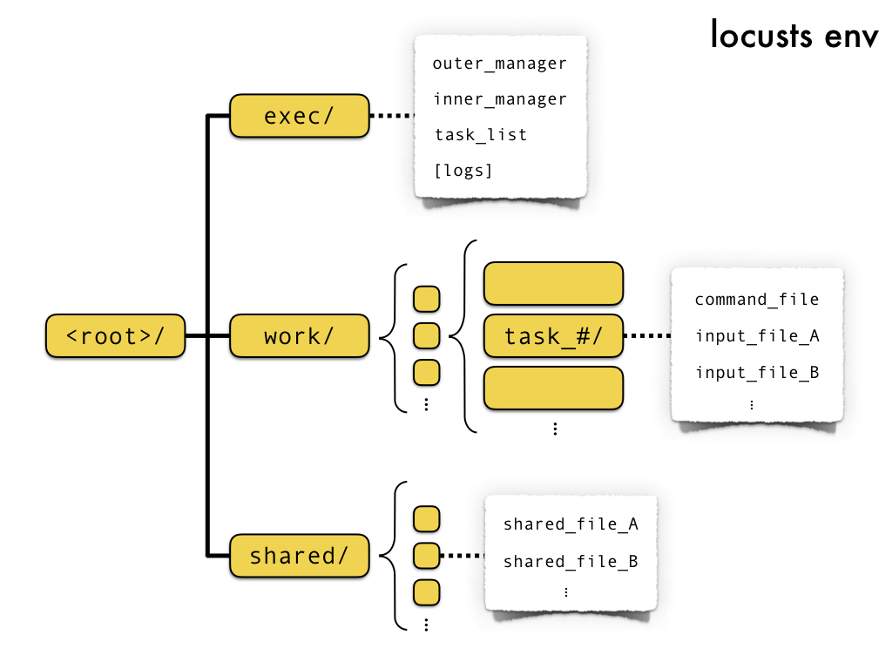
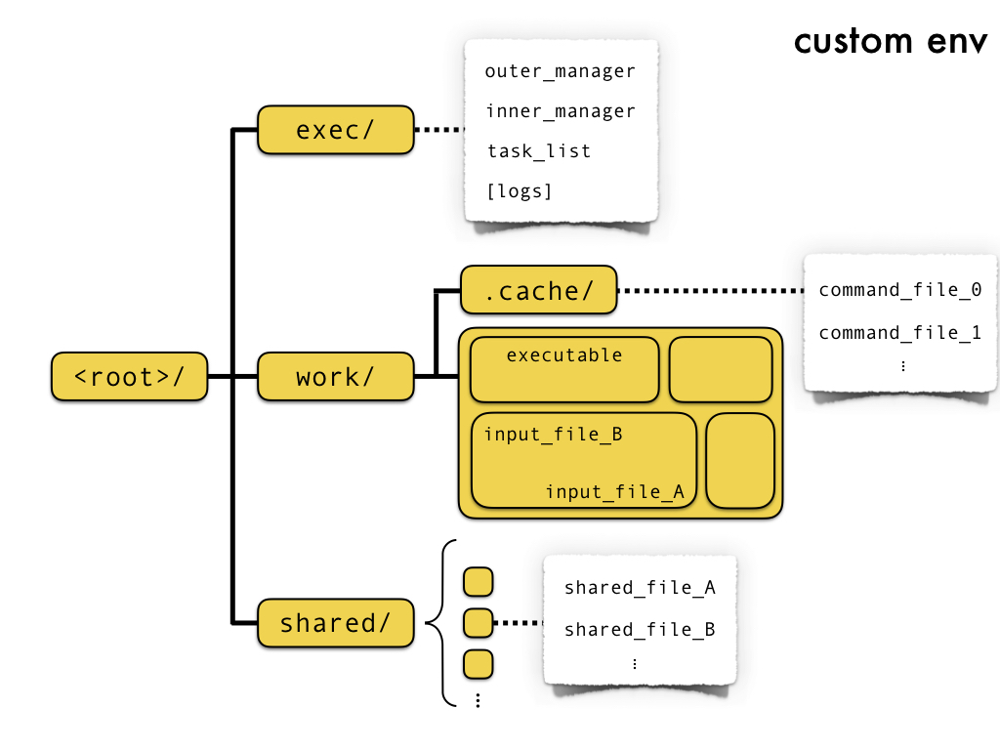

# Locusts

Locusts is a Python package for distributing many small jobs on a system (which can be your machine or a remote HPC running SLURM or OAR).


## Installation

Locusts package is currently part of the [PyPI](https://test.pypi.org) Test archive.
In order to install it, type

`python3 -m pip install --index-url https://test.pypi.org/simple/ --no-deps locusts`

Note: PyPI Test is not a permanent archive. Expect this installation procedure to change over time.


## How it works

Locusts is thought for whom has to run a **huge amount of small, independent jobs** and has problems with the most used schedulers which will scatter the jobs over over too many nodes, or queue them indefinitely.
Moreover, this package provides a **safe, clean environment for each job instance**, and keeps and collects notable inputs and outputs.
In short, locusts creates a minimal filesystem where it prepares one environment for each job it has to execute. The runs are directed by a manager bash script, which schedules them and reports its stauts and the one of the jobs to the main locusts routine, which will always be run locally. Finally, it checks for a set of compulsory output files and compiles a list of success and failures.

### Modes

Locusts can help you distributing your jobs when you are facing one of these three situations:
* You want to run everything on your local machine (**local mode**)
* You want to submit jobs to a HPC (**remote mode**)
* You want to submit jobs to a HPC which shares a directory with your local machine (**remote-shared mode**)

### Environments

Once you give locusts the set of input to consider and the command to execute, it creates the Generic Environment, a minimal filesystem composed of three folders:
* An **execution folder**, where the main manager scripts will be placed and executed and where execution cache files will keep them updated on the progress of the single jobs
* A **work folder**, where the specific inputs of each job are considered and where outputs are addressed
* A **shared folder**, where common inputs have to be placed in case a group of different jobs wants to use them

Basing on this architecture, Locusts provides two types of environments the user can choose from depending on her needs:

#### Default Locusts Environment


If the user only needs to process a (possibly huge) amount of files and get another (still huge) amount of output files in return, this environment is the optimal choice: it allows for minimal data transfer and disk space usage while each of the parallel runs will run in a protected sub-environment. The desired output files and the corresponding logs will then be collected and put in a folder designated by the user

#### Custom Environment

The user could nonetheless want to parallelize a program or a code having more complex effects than taking in a bunch of input files  and returning some outputs: for example, a program displacing files around a filesystem will not be able to run in the Default Locusts Environment. In these situations, the program needs to have access to a whole environment rather than to a set of input files. 


Starting from this common base, there are two different environments that can be used:
* The default Locusts Environment consists in having one folder corresponding to each set of files for running one instance of the command
* The Custom Environment lets the user employ any other filesystem 

## Tutorial

Both examples below are in the `tests/` directory and can be run from the root of the repository (e.g. `python3 tests/test_manager/test_manager.py`). Before running them, edit their parameter file (see [The parameter file](#the-parameter-file)) so that it describes your machine or your HPC.

### Example 1: Running a script requiring input/output management (Default Environment)
You can find this example in the directory `tests/test_manager/`.
In `tests/test_manager/my_input_dir/` you will find 101 pairs of input files: `inputfile_#.txt` and `secondinputfile_#.txt`, where 0 <= # <= 100. Additionally, you will also find a single file named `sharedfile.txt`.
The aim here is executing this small script over the 101 sets of inputs:
```bash
sleep 1;
ls -lrth <inputfile> <secondinputfile> <sharedfile> > <outputfile>;
cat <inputfile> <secondinputfile> <sharedfile> > <secondoutputfile>
```
For each pair, the script takes in `inputfile_#.txt`, `secondinputfile_#.txt` (both vary from instance to instance) and `sharedfile.txt` (which instead remains always the same), and returns `ls_output_#.txt` and `cat_output_#.txt`. In order to mimick a longer process, the script is artificially made to last at least one second.

The file `tests/test_manager/test_manager.py` gives you an example (and also a template) of how you can submit a job on Locusts.
The function you want to call is `locusts.swarm.launch`, which takes several arguments.
Before describing them, let's look at the strategy used by Locusts: in essence, you give Locusts a template of the command you want to execute, and then you tell Locusts where to look for files to execute that template with. In our case, the template is:
```bash
sleep 1;
ls -lrth inputfile_<id>.txt secondinputfile_<id>.txt <shared>sf1 > ls_output_<id>.txt;
cat inputfile_<id>.txt secondinputfile_<id>.txt <shared>sf1 > cat_output_<id>.txt
```
Notice there are two handles that Locusts will know how to replace: `<id>` and `<shared>`.
* The `<id>` handle specifies the variable part of a filename (in our case, an integer in the [0,100] interval). Locusts finds all the values of `<id>` by looking at the names of the files in the input directory, and runs the command once per value.
* The `<shared>` handle marks a file that is the same for all instances: `<shared>sf1` will be replaced by the path of the file declared with the key `sf1` (here `sharedfile.txt`). Shared files are copied only once, in the shared folder, instead of once per instance.

These are the arguments of `locusts.swarm.launch` for the Default Environment:
* `indir` takes the location (absolute path or relative from where you are calling the script) of the directory containing all your input files
* `outdir` takes the location (absolute path or relative from where you are calling the script) of the directory where you want to collect your results
* `code` takes a unique codename for the job you want to launch
* `spcins` (specific inputs) takes a list containing the template names of the input files that vary from instance to instance: here `['inputfile_<id>.txt', 'secondinputfile_<id>.txt']`. Each instance will find its own files in its working folder
* `shdins` (shared inputs) takes a list of `key:filename` strings for the files that are common to all instances: here `['sf1:sharedfile.txt']`. The file must be in `indir`, and the key is what follows `<shared>` in the command
* `outs` takes a list containing the template names of the output files each instance must produce: here `['ls_output_<id>.txt', 'cat_output_<id>.txt']`. Locusts will check for their presence at the end of the run
* `cmd` takes the command template
* `parf` takes the location of the parameter file

```python
locusts.swarm.launch(
    indir=my_input_dir,
    outdir=my_output_dir,
    code=batch_job_code,
    spcins=specific_inputs,
    shdins=shared_inputs,
    outs=outputs,
    cmd=command_template,
    parf=parameter_file
)
```

When the run is over, `outdir` contains:
* `batch_0/task_MngTest000000/` ... `batch_0/task_MngTest000100/`, one folder per instance, with the outputs it produced (instances are grouped in `batch_N/` folders of `batch_size` instances each)
* `output.log`, listing each expected output with its status (`present`, `error` or `missing`) and its path
* `MngTest.exec_file.txt`, the list of all the commands Locusts compiled from your template
* `logs/`, containing the list of tasks each node had to run
* `.cache/run.log`, a summary of the run (see [Hidden files](#hidden-files))

### Example 2: Running a program acting on a whole filesystem (Custom Environment)
You will find the material for this example in the directory `tests/test_customenv/`.
Here, the program does not simply transform inputs into outputs: `environment/all_scripts/important_script.sh` reads files from other folders of `environment/`, copies them into other folders depending on their content, modifies scripts and creates new folders and logs. It needs to run inside the whole `environment/` filesystem, and we want to run it 20 times, each with a different argument (`0-9`, `10-19`, ..., `190-199`).

In the Custom Environment, instead of input and output templates, you give Locusts:
* `envroot`: the root directory of the environment the program needs (here `tests/test_customenv/environment/`)
* `envfs`: a filesystem specification file (here `tests/test_customenv/fs_tree.fst`) telling Locusts which parts of the environment must be replicated where the jobs run. This keeps data transfer to a minimum when the environment contains big files the program does not need
* `args`: a list with one element per instance; each element is the list of arguments of that instance. In the command, `<arg0>` is replaced by the first argument, `<arg1>` by the second, and so on
* `locdir`: a local directory where Locusts will store its caches, build the filesystem before transferring it, and write the logs

```python
argument_list = [[str(10*x)+"-"+str(10*(x+1)-1)] for x in range(20)]   # [['0-9'], ['10-19'], ...]
command_template = 'bash important_script.sh <arg0>'

locusts.swarm.launch(
    code="MngTest",
    cmd=command_template,
    args=argument_list,
    envroot="tests/test_customenv/environment/",
    envfs="tests/test_customenv/fs_tree.fst",
    parf="tests/test_customenv/test_customenv.par",
    locdir="tests/test_customenv/my_local_dir/"
)
```

#### The filesystem specification file
The `.fst` file describes the part of the environment to replicate, folder by folder. Here is the one of this example:
```
#WORKDIR : all_scripts/

all_scripts :
	important_script.sh
	yep :
	helper_scripts : *
		.*
important_files : *.txt
	! big_file.txt
other_files_1 :
	class_A : **
		! useless_folder/
		! useful_folder/very_big_file.txt
	class_B : **
```
The syntax is:

| Line | Meaning |
|------|---------|
| `#WORKDIR : <path>` | Compulsory. The folder (relative to `envroot`) from which the command is launched |
| `name` | A file |
| `name :` | A folder. Only the items listed below it (one tab deeper) are replicated: `yep :` alone creates an empty `yep/` folder |
| `name : <pattern>` | A folder, along with the files matching the pattern (e.g. `*`, `*.txt`). Subfolders are not included |
| `name : **` | A folder with all its contents, recursively |
| `! <path>` | Exclude the files and folders matching the path |
| `!! <path>` | Exclude the files matching the path, but keep the folder structure |
| `# ...` | A comment |

Indentation must be made with **tabs**, not spaces: each level of indentation enters the folder of the line above.

Notice the `.*` line under `helper_scripts`: wildcards (`*`, `*.txt`, `**`) **never match hidden files**, i.e. files whose name begins with a dot. If your program needs hidden files, you must list them explicitly, either by name or with a `.*` pattern, as done here for `.secretyep.txt` and `.secretyep1.txt`.

#### What happens to the environment
All the instances run in **the same copy** of the environment (from `#WORKDIR`). Unlike the Default Environment, they are not isolated from each other: make sure that instances running at the same time do not write the same files (in this example, every instance appends a line to `as_useless_3.sh` and `be_polite.sh`, which is harmless but shows the issue).
* In local mode, the commands run directly in `envroot`, which is modified in place.
* In remote modes, the selected part of the environment is replicated on the HPC. At the end of the run, Locusts compares the remote filesystem with the snapshot taken before the run, copies all the files that were created or modified back into `envroot`, and lists them in `<locdir>/logs/modified.log`.

In both cases `envroot` **is modified**: keep a copy if you need to go back to the original state (that is what `tests/test_customenv/environment_copy/` is for). Locusts does not check the outputs of a Custom Environment run.


## The parameter file
The parameter file contains one option per line, in the format `option_name value`. Everything following a `#` is a comment. Options that are not specified take their default value.

| Option | Default | Description |
|--------|---------|-------------|
| `run_on_hpc` | `False` | Submit the jobs to a remote HPC through SSH (**remote mode**, or **remote-shared mode** if `local_shared_dir` is set) |
| `run_on_hpc_local` | `False` | Locusts runs directly on the HPC (e.g. on a login node) and submits the jobs from there |
| `host_name` | | The HPC address for the SSH connection. A passwordless connection is needed (e.g. with `ssh-agent` and `ssh-add`) |
| `hpc_exec_dir` | | Path on the HPC where the jobs will be executed and the temporary files stored. Its parent folder must exist; the folder itself must not |
| `local_shared_dir` | | Local path of a folder shared with the HPC. In this case, `hpc_exec_dir` must be the path of the same folder as seen from the HPC |
| `scheduler` | `slurm` | `slurm` or `oar` |
| `requested_nodes` | | Maximum number of nodes to use |
| `cpus_per_node` | | Number of tasks run at the same time on each node |
| `min_stack_per_core` | `10` | Minimum number of tasks per core: if there are few tasks, fewer nodes than `requested_nodes` are used |
| `partition`, `constraint`, `exclusive`, `walltime`, `memory`, `memory_per_cpu` | | Scheduler requests for each node (`walltime` format: `HH:MM:SS`, default `24:00:00`) |
| `nodewise_scratch_folder`, `nodewise_scratch_space` | | Local scratch space on each node (both or none) |
| `email_address` | | Address for the scheduler notifications |
| `extra_outer_statements` | | Statements added to the job script before the tasks are launched (e.g. `module load ...`) |
| `singularity`, `singularity_container`, `singularity_modload` | | Singularity executable, container and module loading statement, if the tasks have to run in a container |
| `number_of_processors` | `1` | Number of tasks run at the same time in local mode |
| `data_transfer_protocol` | `rsync` script | A script taking a source and a destination, used for all file transfers to and from the HPC |
| `transfer_archive` | `False` | Send the filesystem to the HPC as a single `.tar.gz` archive instead of file by file (much faster with many small files) |
| `diskspace_required` | | E.g. `50G`. Before starting, check that at least this much space is free where `hpc_exec_dir` will be created |
| `checkquota_command` | `checkquota` | Command printing the disk quotas as `<mount>: <used> <quota> ...` lines. If it is not available, `df` is used instead |
| `staggered` | `False` | Do not launch all the tasks of a node at the same time, but one every `stagger_time` seconds (useful when tasks read heavily at startup) |
| `stagger_time` | `300` | Seconds between two staggered task launches |
| `batch_size` | `10000` | Maximum number of task folders in each `batch_N/` folder |
| `waiting_time` | `-1` | Seconds between two checks of the jobs status (`-1`: chosen automatically) |
| `only_gather` | `False` | Do not submit anything: only collect the results of a previous run (see [After a killed run](#after-a-killed-run)) |


## Hidden files
While running, Locusts keeps track of the progress of each node with a set of hidden files (whose name begins with a dot). You should never need to edit them, but it is useful to know what they are when something goes wrong.

`<code>` is the code of the run, and `<NNN>` is the 3-digit number of a node (`000`, `001`, ...).

In the execution folder (`exec_dir/`, under `hpc_exec_dir` in remote modes, or under `.cache/<code>_tmp_root/` in local modes):

| File | Content | Usage |
|------|---------|-------|
| `.manager_activity_check_<code><NNN>` | The name of the machine running the node | Touched regularly by the node manager: its modification time tells when the node was last seen alive |
| `.runningjobs_<code><NNN>.txt` | One line (`index task_id running folder`) for each task that was started | Appended to by the node manager, never truncated |
| `.donejobs_<code><NNN>.txt` | One line (`index task_id done folder`) for each task that ended | Appended to by the node manager, never truncated |
| `.currentlyrunning_<code><NNN>.txt` | The tasks started but not yet ended | Rebuilt by the node manager at each cycle: its number of lines is the number of busy CPUs. Deleted when the node has finished all its tasks |
| `.status_<code><NNN>.tmp.txt` | Temporary copy of `status_<code><NNN>.txt` | Exists only for a moment, while the status file is updated |

Elsewhere:

| File | Content |
|------|---------|
| `<outdir or locdir>/.cache/` | Local cache: the local build of the filesystem (`<code>_tmp_root/`, which is also where the jobs run in local modes) and `run.log`, the summary of the run |
| `<code>/.cache/tasks/` (in the work folder) | Custom Environment only: the task scripts, kept outside the replicated environment |
| `.cache/<code>_transfer.tar.gz` and `.<code>_transfer.tar.gz` in the parent folder of `hpc_exec_dir` | Only with `transfer_archive`: the archive of the filesystem, deleted as soon as it is extracted |

### After a killed run
If a run is interrupted (you stop Locusts, the connection is lost, the jobs hit the walltime...), its hidden files stay where they are. Whether you have to delete them before the next run depends on what was killed and on the mode.

**First, find out what is still running.** Stopping Locusts does **not** stop the jobs it launched: they keep running on the HPC (or in the background, in local mode), and keep writing into the hidden files. Check with `squeue -u $USER` (SLURM) or `oarstat -u` (OAR), or `ps aux | grep manager_<code>` in local mode.

**If you want to collect the results of the interrupted run** (only Locusts was stopped, while the jobs completed or are still running on the HPC): do **not** delete anything. Wait until the jobs are over, then launch the same script again, with the same `code`, after adding `only_gather True` to the parameter file. Locusts will not submit anything: it will directly collect the results. Notice that with `only_gather` Locusts does not wait for the jobs, so make sure they are all over. This is only possible in remote and remote-shared modes, because in local modes the files are in the local `.cache/`, which is deleted when Locusts starts.

**If you want to start again from scratch**:
1. Stop the old jobs, **before** relaunching (in local modes, the list of the jobs is in the `.cache/` that relaunching deletes). Their IDs are in `exec_dir/submit.log`:
   * SLURM: `awk '{print $2}' <exec_dir>/submit.log | xargs scancel`
   * OAR: `awk '{print $2}' <exec_dir>/submit.log | xargs oardel`
   * Local mode: `pkill -f manager_<code>`
2. Delete the old files, depending on the mode:

| Mode | What to do |
|------|------------|
| local, local HPC (`run_on_hpc_local`) | Nothing: `.cache/` (including the hidden files and the `logs/` folder) is deleted automatically when Locusts starts |
| remote | Delete `hpc_exec_dir` on the HPC: `ssh <host_name> rm -rf <hpc_exec_dir>`. Locusts refuses to start if it is still there, and prints this command. Also delete `.<code>_transfer.tar.gz` in its parent folder, if present |
| remote-shared | Delete `exec_dir/` and the `<code>/` folder in `local_shared_dir`. Locusts refuses to start if they are still there, and prints the command. Since `.runningjobs_*` and `.donejobs_*` are only appended to, the old ones would mix with the new run: tasks marked as done in the old run would be skipped, tasks killed while running would keep their CPU busy forever, and old outputs would be collected as if they were new |

In the Custom Environment, remember also that `envroot` may have been partially modified by the interrupted run (in local mode, directly; in remote modes, only if Locusts had reached the end of the run). Restore it from your copy if needed.
